<h1 align="center">Hi 👋, I'm Sandeep Kushwaha</h1>

<h3 align="center">B.Tech AI & ML Student | Aspiring Data Scientist | Java & Data Structures and Algorithms (DSA)</h3>

  I enjoy exploring data, building machine learning projects, and solving problems with Java.

  
  
  

  

---

## 👨‍💻 About Me

- 🎓 Pursuing **B.Tech in Artificial Intelligence & Machine Learning** at Lakshmi Narain College of Technology, Bhopal.
- 📊 Interested in **Data Science, Machine Learning, data analysis, and building practical applications**.
- ☕ Practising **Data Structures and Algorithms using Java**.
- 🌱 Currently exploring **Generative AI** and strengthening my machine learning knowledge.
- 💬 Ask me about **Python, Data Science, Machine Learning, SQL, Java, and DSA**.
- 📫 Reach me at **[sandeep188288@gmail.com](mailto:sandeep188288@gmail.com)**.

---

## 🚀 Featured Projects

<table>
  <tr>
    <td width="50%" valign="top">
      <h3>🤖 Fake Job Post Detector</h3>
      
A machine learning application that predicts whether a job posting is real or fraudulent. It uses an XGBoost model with a FastAPI backend and a web interface.

      
<strong>Tech:</strong> Python · XGBoost · Scikit-learn · FastAPI · Docker

      <a href="https://github.com/sandeep188288-netizen/Fake_job_predictor">View Repository →</a>
    </td>
    <td width="50%" valign="top">
      <h3>🎓 Placement Prediction System</h3>
      
A machine learning web application that predicts student placement outcomes from student-related information. Deployed on Render.

      
<strong>Tech:</strong> Python · Machine Learning · FastAPI · Pandas · NumPy

      <a href="https://github.com/sandeep188288-netizen/ML_model-Placement_prediction-">Repository</a> ·
      <a href="https://ml-model-placement-prediction-4.onrender.com/">Live Demo</a>
    </td>
  </tr>
  <tr>
    <td width="50%" valign="top">
      <h3>🔍 Quora Duplicate Question Detection</h3>
      
An NLP and machine learning project that identifies whether two Quora questions have the same meaning, with text preprocessing and feature engineering.

      
<strong>Tech:</strong> Python · NLP · Scikit-learn · CountVectorizer · Streamlit

      <a href="https://github.com/sandeep188288-netizen/nlp_proj01">View Repository →</a>
    </td>
    <td width="50%" valign="top">
      <h3>☕ Java DSA Practice</h3>
      
Java notes and problem-solving practice covering data structures, algorithms, and LeetCode questions.

      
<strong>Tech:</strong> Java · Data Structures · Algorithms

      <a href="https://github.com/sandeep188288-netizen/DSA-JAVA-intelliJ">Java DSA Notes</a> ·
      <a href="https://github.com/sandeep188288-netizen/leetcode-DSA">LeetCode Solutions</a>
    </td>
  </tr>
</table>

---

## 🛠️ Tech Stack

### Programming

  
  
  

### Data Science & Machine Learning

  
  
  
  
  
  

### Development & Tools

  
  
  
  
  
  

### Areas of Interest
`Data Science` · `Machine Learning` · `Deep Learning` · `Generative AI` · `Natural Language Processing` · `Java DSA`

---

## 📊 GitHub Analytics

<!-- These SVG cards are generated and refreshed by the GitHub Actions workflow in .github/workflows/profile-cards.yml. -->

### Profile Overview
<picture>
  <source media="(prefers-color-scheme: dark)" srcset="./assets/overview.dark.svg"/>
  
</picture>

### Contribution Activity & Streak
<picture>
  <source media="(prefers-color-scheme: dark)" srcset="./assets/contributions.dark.svg"/>
  
</picture>

### Contribution Trend
<picture>
  <source media="(prefers-color-scheme: dark)" srcset="./assets/momentum.dark.svg"/>
  
</picture>

### Commit Activity
<picture>
  <source media="(prefers-color-scheme: dark)" srcset="./assets/cadence.dark.svg"/>
  
</picture>

### Top Repositories
<picture>
  <source media="(prefers-color-scheme: dark)" srcset="./assets/repositories.dark.svg"/>
  
</picture>

### Most Used Languages
<picture>
  <source media="(prefers-color-scheme: dark)" srcset="./assets/languages.dark.svg"/>
  
</picture>

---

## 🌐 Connect With Me

  
  
  
  
  
  

---

  <b>Thanks for visiting my profile! 😊</b> 
  Feel free to explore my repositories and connect with me.

